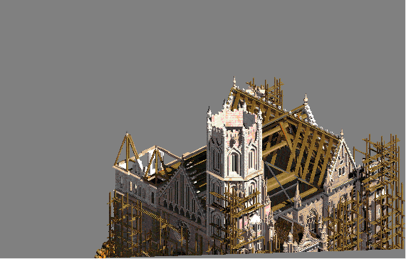
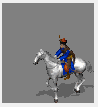

# GPAK tools

*this project is still under development*

[](https://github.com/klym1/Gpak-tools/actions/workflows/build.yml)

## Description

C# library for reading **GPAK** files (have *.gp* extension) which were utilized for storing graphical data in some old games (such as **Cossacks** and **American Conquest** from **GSC Game World** company). Library produces Bitmap objects which can be saved using ordinary image format (e.g. *PNG*).

Format specs were reverse engineered completely from scratch. All GP files of Cossacks: European Wars decode.

## Goals

This project is rather for "prototyping" purposes then for real world usage. 

Main goal is to recover (or reverse engineer) image format specs and implement some sort of converter to common image format. And I'm happy, because this goal is almost achieved. 

Next goal is to improve code quality, improve performance and make usable for real world applications (maybe for HTML5 games).

## Dev/Run

Requires the [.NET 10 SDK](https://dotnet.microsoft.com/download). Everything works on Windows, Linux and macOS.

```
dotnet build src/GPExtractor.sln
dotnet test src/GPExtractor.sln
```

The viewer puts the game's units on a field. Open the game's `All.gsc` (or a folder extracted from it; both can also be dropped on the window); the viewer opens it again the next time it starts:

```
dotnet run --project src/Viewer -- [All.gsc | extracted-folder]
```

The field:

- It starts with two armies, blue (selected) and red: a cannon, a musketeer, a grenadier, a pikeman and a dragoon each.
- Picking a unit or a building in the **Add** lists (one of units, one of buildings) puts it there in the picked color.
- Click a unit, or drag a box around several, to select them (Shift adds to the selection; Delete or **Remove** takes them off).
- Ctrl+C copies the selected units and Ctrl+V puts copies of them around the pointer, placed and colored as they were.

Moving:

- Right-click sends the selection somewhere: each turns to the nearest direction, walks (one step of a few pixels per animation frame) to its own place in a block around the point and stands again when it arrives.
- Units find a way around the others instead of walking through them, wait behind one walking their way, and pass one coming towards them on the right.
- A unit takes the room of its `GEOMETRY` radius and walks as fast as its step (32 being a foot soldier's). One with `ROTATE` turns where it stands, that many 256ths of a turn a tick, before it walks or fires (a ship, `MOTIONSTYLE SHEEPS`, turns as it goes).

Fighting:

- **Attack** plays the selected units' attack once (a list next to it picks which, for units with several, e.g. a grenadier's bayonet, musket or grenade).
- Right-clicking a unit of another color sends the selection against it: each comes within reach (close by for a blade, as far as the attack's `ATTACK_RADIUS` for a firearm; nearer than its minimum the unit makes another of its attacks, or none if it has no other), turns to it and attacks, and the enemy fights back. A unit makes the attack whose `DET_RADIUS` the enemy is in.
- Every attack takes its `DAMAGE`, less the other's armor (`SHIELD`, and its `PROTECTION` against the attack's `WEAPONKIND`), from the other's `LIFE`, until one falls: a blow as it ends, a shot where and when it lands, on whoever stands within its blast radius (the fourth column of the weapon's `[MEMBERS]` line), falling off evenly to nothing at its edge. A bar above a wounded unit shows the life left.
- An attack is followed by a rest of its `ATTACK_PAUSE` (taken as ticks); with `SHOWDELAY` a white bar under the life bar shows how far the rest has got.
- Shots land up to `RAZBROS` pixels per 2000 of distance each way from their aim, and one that lands on its target hits it at the height of its `ZPOINTS` (the second number).
- A blow, too, is struck from as far as its `ATTACK_RADIUS`, measured on the ground.
- A line on the field gives each side's units, their strength (the sum of their `FORCE`) and its score: a side gains a unit's `VES` when the unit is put on the field, loses twice that when it dies, and the side that killed it gains as much; the score is shown in hundredths, as the game does.
- With **Fog of war** on, units of other colors are hidden, and cannot be clicked, unless a living unit of the picked color sees them: 200 pixels, and for a `VISION` of 1 or 2 one step of 128 more, for 3 to 8 two to seven steps.
- Standing idle, a unit takes on the nearest enemy within its `SEARCH_ENEMY_RADIUS`, unless **Stand ground** (for units with `STANDGROUND`) holds it to those within reach.
- An attack with an `ATTMASK` is made, and does damage, only on what is made of one of the materials it names (the other's `MATHERIAL`), so grenades and fire arrows are kept for buildings. An attack without a mask is held to the unit's `CANKILL` materials the same way: a unit neither takes on nor can be sent against an enemy none of its attacks is for, so foot soldiers (`CANKILL 1 BODY`) leave cannons (iron) and ships (wood) alone.

Animations and sounds:

- A unit that has them brings its weapon up before attacking (`PATTACK`), holds it ready between attacks (`PSTAND`) and lowers it after (`UATTACK`), and takes a rest (`REST`) now and then when idle.
- **Kill** plays the selected units' death, after which they lie, decay through their `DEATHLIE` stages and leave the field.
- A unit sounds its `SELECT_SOUND` when it is selected, its `ORDER_SOUND` when it is sent somewhere or against an enemy and its `BORN_SOUND` when it is put on the field.

Extract the game's `.gsc` archives (e.g. `All.gsc` from Cossacks), optionally keeping only paths that contain a filter such as `.gp`:

```
dotnet run --project src/GscExtractor -- <archive.gsc> <output-folder> [name-filter]
dotnet run --project src/GscExtractor -- --list <archive.gsc> [name-filter]
```

| Project | Purpose |
|---|---|
| `GPExtractor` | GP file decoding (`GpFile`), `.gsc` archive reading (`GscArchive`) |
| `ImageRenderer` | Compositing frames to RGBA (`GpRenderer`), palettes, built-in PNG encoder |
| `Types` | `ImageView` pixel buffer |
| `GscExtractor` | Extracts `.gsc` game archives (`GscArchive` in `GPExtractor` does the reading) |
| `Viewer` | Desktop image viewer ([Avalonia](https://avaloniaui.net/)) |
| `UnitTests`, `ViewerTests` | Tests; `ViewerTests` run the viewer headlessly |

The core library has no native or imaging dependencies. The tests decode synthetic GP data for every encoding and include pixel-exact regression checks of `gp/test.gp`.

On Linux the viewer (and `ViewerTests`) need fontconfig (`libfontconfig1`), which desktop distributions already include.

NuGet dependencies (NUnit, FluentAssertions, Avalonia) are restored automatically on build.

## GP sprite format

All integers are little-endian.

| Offset | Size | Content |
|---|---|---|
| `0x00` | 4 | Signature `GPAK` |
| `0x04` | 2 | Number of frames *N* |
| `0x06` | 2 | Unknown |
| `0x08` | 4 | Offset of the shared color dictionary |
| `0x0C` | 2 | Length of the dictionary |
| `0x0E` | 4 × *N* | Frame offsets |

A frame is a chain of parts drawn on top of each other (typically shadow, body, anti-aliased edges, player color). Each part starts with a 23-byte header:

| Offset | Size | Content |
|---|---|---|
| `+0` | 4 | Offset of the next part, relative to the frame; -1 for the last |
| `+4` | 2 × 4 | x, y, width, height |
| `+12` | 4 | Always -1 |
| `+16` | 1 | Part type (below) |
| `+17` | 4 | Bits 0-13: offset of the color data + 1; bits 14-31: number of pixel values |
| `+21` | 2 | Number of rows |

The header is followed by one entry per row saying which pixels are drawn, as runs of (skip, length):

- `0x00`: empty row.
- `0x01`-`0x7F`: that many runs follow, as byte pairs (skip, length).
- `0x80`-`0xFF`: the low 5 bits are the number of runs, one byte each (low nibble skip, high nibble length); bit `0x40` adds 16 to every skip, bit `0x20` to every length.

After the rows comes one unused byte, then the color data. The pixel values fill the runs in order, across rows:

| Type | Meaning | Color data |
|---|---|---|
| 0 | Opaque pixels | Groups of a control byte and 8 items, from the control byte's highest bit down. Bit 0: one palette index. Bit 1: two bytes `a`, `b`; copy `(b >> 4) + 3` indices from the dictionary at `a \| (b & 0x0F) << 8` |
| 1 | Player color | 2 bits per pixel, lowest bits first: palette index `player base + value` (e.g. `0xD0` red); padded with 1-4 values at the end |
| 2, 3, 4 | Anti-aliased edges (2 outermost, 4 innermost) | One palette index per pixel |
| 5 | Shadow | None |
| 7 | Light: smoke, explosions, splashes | One value per pixel: brightness level × 8 + step, a row of the light table (below) |
| 39 | Interface graphics and fonts | One palette index per pixel |
| 42 | Opaque pixels of large pictures (buildings, borders) | As type 0, but from the control byte's lowest bit up, and bit 1 is two bytes `a`, `b`: copy (`b` >> 5) + 3 pixels, starting (`a` \| (`b` & 31) << 8) + 1 pixels back in what this part has produced so far |
| 255 | Empty frame | None |

The opacity of types 2, 3 and 4 is not stored in the file. The renderer uses 25 %, 50 % and 75 %; the game's 256-row tables `AGEW_TR4.GRD` and `AGEW_TR.GRD` mix two palette colors 1:3 and 1:1, which fits. Type 7 goes through the light table `ALPHAW.GRD`: of its rows 0-159, row level × 8 + step maps every background color to that color dimmed to (7 − step) / 8 plus the gray of the level (20 levels, 0 to 216). So step 0 is a faint glow and step 7 solid gray; the renderer draws the same as a gray at an opacity of (step + 1) / 8.

### Directions

Unit, ship and projectile sprites store each pose from several directions, frame-major: frame `pose × D + direction`. The descriptors (`*.MD`, next to the sprites in `All.gsc`) give *D* per animation, e.g. `#MOTION_L  9 10  1 0 1 1 ...` (9 directions, 10 poses as sprite/pose pairs), and the anchor in `USERLC 1 ba1g  SHADOW -62 -90` (x = 62).

With *D* = 2^n + 1 (9, 17, 33, 65, 129), the stored directions cover half a turn, from facing the viewer (south) clockwise to facing away (north); the game mirrors them around the anchor for the eastern half, giving 2 × (*D* − 1) directions. `GpDirections` reads this from the descriptors or, for sprites without one, recognizes it from the frames, and the viewer plays the poses of a chosen direction.

The directions are evenly spaced on the ground, which the game shows at a slant of 2:1: the weapon points of `SETACTIVEPOINT`, one per direction, lie on an ellipse half as high as wide (ratios of 0.45 to 0.54 for 33 of the 35 attacks that have them). So a unit moving two pixels left for one down faces south-west, and the viewer picks directions that way.

### Units

Each descriptor (`*.MD`) describes one game object. Objects whose animations have directions are units (92 in Cossacks: European Wars); the others are mostly buildings. A unit's states are its animations, written either as (sprite, pose) pairs or as a range of poses, `@MOTION_LB 9 1 19 10` (sprite 1, poses 19 down to 11; the end is not included). `MESSAGE` holds the display name in DOS (866) or Windows (1251) Cyrillic.

`GameCatalog` reads the descriptors from a folder or straight from a `.gsc` archive (`GameFiles`) and loads sprites on demand. The viewer places every sprite of a unit with its anchor at the same point, so the unit stays in place across states and directions.

Buildings are the objects without directions that have a `STANDLO` state (192 of them). The frames of their states are not shown in turn but together, as layers: `#STANDLO 1 2 0 8 0 9` draws frame 8 (the ground with the shadow) and frame 9 (the walls) of sprite 0; `BUILDLO_0`-`3` are the stages of building and `DEATHLIE1`-`2` the ruins. The viewer lists them after the units; on the field they stand on the middle of their ground layer, do not move, are walked around and can be shot and destroyed.

### Sounds

A descriptor line `SOUND frame #ANIMATION name` plays a sound at a frame of an animation (a drum beat in `MOTION_L`, a cry in `DEATH`). `SOUNDLIST.TXT` gives the wave files of each name, relative to the game folder: a line `NAME count`, an optional line `DANGER`, then `count` file lines, of which the game plays one. Shots come from the weapons: a descriptor line `WEAPON n name` gives the weapon of attack *n* (animation `ATTACK`/`ATTACK0`, `ATTACK1`, …), `SETACTIVEPOINT #ATTACK frame …` the frame it fires at, and the `[SOUND]` section of `WEAPON.NDS` (`WeaponList`) the sound of a weapon, or of a weapon its `[SYNCWEAPON]` line launches with it. The impact sounds like the nearest weapon born when it explodes (`[CHILDWEAPON]`), e.g. the blast of a cannonball; the viewer plays it a moment after the shot. `GameCatalog.SoundsOf` puts these together. The viewer plays them (the wave files are in the game's `Sound` folder, next to `All.gsc`): on Windows through its multimedia interface, on macOS with `afplay`, on Linux with `paplay` or `aplay`, whichever is installed.

### Weapon effects

Smoke and explosions are animations of the weapons. `WEAPON.ADS` is written like a descriptor and defines them (`@DIM32 17 26 0 25` is the smoke of a cannon, from 17 stored directions); the `[MEMBERS]` section of `WEAPON.NDS` gives each weapon its animation, how it moves and for how many cycles. A weapon that stays in place is drawn where it appears: at the unit's weapon for those launched with the shot, where the shot lands for those that a travelling weapon (one that flies without a cycle limit) leads to. A travelling weapon with an animation of its own (a cannonball, an arrow) is drawn flying between the two, in an arc for its launch angle (`ANGLE n`), for as long as such a throw takes, or for the distance at its speed (`FLY n`, taken as pixels a tick). The weapon's place on a unit is the point of its `SETACTIVEPOINT` line for the direction it faces. Smoke is see-through: a weapon's transparency (`WHITE` for cannon smoke) names a blend table of 32 rows (`AGEW_1W.GRD`), in which row *n* turns every palette color a step further into one color, light gray; the brightness of each smoke pixel picks the row. The viewer draws it as that color, the more opaque the brighter the pixel. `WeaponList.EffectsOf`, `GameCatalog.ShotsOf`, `GameCatalog.Effect` and `GameCatalog.BlendTable` give these, and the viewer plays them when a unit fires.

## RLC sprite format

Fonts, cursors and a few older sprites are `.rlc` files (`RlcFile`): the signature `RLC` `0x1B`, a uint32 number of frames *N*, and *N* uint32 frame offsets. A frame is a uint16 width, a uint16 height, and one entry per row: a byte with the number of runs, then per run a byte of transparent pixels to skip, a byte with the length and that many palette indices. The viewer draws units whose descriptors name an RLC sprite (the drummer, `BA1`, stands in one). RLC has no separate player-color parts: the pixels in the red player ramp (palette 208-211) are the player color. The drummer has about ten of them a frame, where his GP walk sprite has its player-color part; indices of the other ramps are ordinary colors (the orange of the drum, black, white).

## GRD color tables

`.grd` files (`GrdTable`) have no header: they are rows of 256 palette indices, each mapping every palette color to another one. The game data has tables of 12, 16, 32, 160 and 256 rows.

## GSC archive format

Cossacks keeps its data in `.gsc` archives (`All.gsc` holds about 2,400 files: GP sprites, palettes, bitmaps, unit definitions, texts). Integers are little-endian:

| Offset | Size | Content |
|---|---|---|
| `0x00` | 6 | Signature `GSCfmt` |
| `0x06` | 4 | Unknown |
| `0x0A` | 4 | Number of files *N* |
| `0x0E` | 81 × *N* | Directory records |
| after directory | … | File data, back to back |

Each record: 4 unknown bytes (hash?), a 64-byte NUL-terminated name with `\` as the folder separator, the bitwise NOT of the data offset (relative to the start of the data area), the size, 4 zero bytes and a 0/1 flag of unknown meaning.

Every file except GP sprites (which start with `GPAK`) is obfuscated by XOR-ing each byte with `0x78`.

## Examples

Samples:



